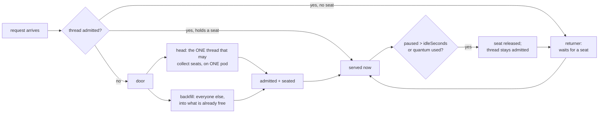

# Why this scheduler exists, and what each part is for

This file records the **intent** behind the group scheduler's `nca2` mode and the two layers added on top of it on this branch —
the **door fix** (`doorBackfill`, with its option `backfillReclaim`) and the **session layer** (`sessionAware`). The README says how to
configure it; this file says what it is trying to achieve, why each rule exists, what was measured that led to it, and what it is
deliberately **not** trying to do. When a rule here and the code disagree, the code is wrong or this file is stale — fix one of them.

---

## 1. The goal

**A serving platform's clients are sessions** — an agent working on a task, issuing a request, thinking (running tools), issuing the
next, spawning sub-agents that issue their own. A session "feels good" when it **runs steadily**:

- every request waits a little — a few seconds is fine in human terms — and **no request is ever stuck** for minutes;
- the whole task takes not much longer than it would on an empty cluster;
- if the platform is full, the waiting happens **at the start** ("please wait, starting your task"), never as a freeze in the middle.

The platform's goal is then: **serve as many sessions at once as the hardware can carry, each of them steadily.** Raw tokens per second
only matter insofar as they buy that.

### 1.1 The physical limits

- **GPU compute** sets the total work per second. Nothing beats it; the only choice is how it is *divided*.
- **GPU memory** limits how many sessions' contexts (KV) can be on the GPU at once.
- **The CPU KV tier** (KV offload) lets contexts of sessions that are *thinking* live on the CPU and come back warm. It is **not
  additive**: everything the GPU creates is written through to it, so a pod can keep at most the CPU tier's size warm, not CPU + GPU.
  On our cell the CPU tier is about **2.2×** the GPU's KV memory — the ceiling of what admission can buy.

### 1.2 How the waiting can be divided (the core idea)

Total waiting is fixed by compute. A scheduler only decides **who waits, when, and in what lumps**:

| approach | what a session experiences |
|---|---|
| a few sessions run nonstop, others are paused | 1 s, 1 s, 1 s … then stuck for 30 minutes |
| everyone shares, but in long turns | fast, then stuck for minutes, then fast |
| **everyone shares in short turns; new sessions wait at the start** | ~a few seconds every request, never stuck — **the goal** |

Example — a task of 20 requests: "bumpy" = 17 × 1 s + 3 × 10 min ≈ 30 minutes of waiting; "steady" = 20 × 5 s = 100 s.

### 1.3 Why seconds are not enforced directly

Promising a latency in seconds requires knowing future work; it is not enforceable. Instead the scheduler controls **how many threads
are inside** (the admission line, §3) and **how often seats rotate** (quantum, idle release, §4). The line is the experience knob:
admit fewer and the inside is steadier; admit more and more sessions are served but each competes for seats more.

---

## 2. Vocabulary

- **thread** — one conversation lineage (the thread-identity plugin derives it from the request content): a root agent or one
  sub-agent. The scheduler's unit.
- **session** — a whole task: the root thread and every sub-agent it spawned. Identified by a request header (§6) when the client sends
  one; otherwise every thread is its own session.
- **admitted** — the thread has an entry in its pod's **CPU line** (§3). **Seated** — it currently holds a **GPU seat** (§4).
- **outsider** — waiting and not admitted (at the door). **returner** — admitted, waiting, not seated (needs a seat back).
- **head** — the one outsider allowed to *collect* GPU budget (§5). **collection pod** — the one pod where it collects.

---

## 3. The CPU tail — who stays admitted (v2, unchanged by the layers)

Each pod keeps a **CPU line**: its admitted threads ordered by last use, most recent on top, sized in tokens against the CPU tier.
Admitting or serving a thread puts it on top; everyone else moves down; whoever crosses the bottom (the **admission line**,
`admitLine × cpuTierTokens`) **loses admission** (is pushed out). An admission may push out only threads that have **no request** and sit
below the lowest thread that has one.

**Why:** the line is how the platform decides which contexts it keeps warm. A thread with a waiting request is never pushed out by an
admission — it is protected by being served. A thread that is thinking can fall off; that is accepted (we cannot evict engine blocks, we
can only decide whom to serve).

Example (one pod, a line of 10 units): `X` (3, being served), `Y` (2, finished, no request), `W` (4, **has a request waiting**), 1 free.
A new thread `N` of 3 units wants in. The lowest thread with a request is `W` at the bottom — nothing below it may be pushed — so `N` waits.
When `W` is served it jumps to the top; now `Y` (no request) sits below the lowest requester `X`, so room = 2 + 1 = 3, `N` enters and `Y` is
pushed out — nothing useful lost.

**What the line means in practice** (measured, one pod of our cell, CPU tier 5.59 M tokens, GPU KV 2.55 M tokens):

| admitLine | admitted tokens | vs GPU memory | effect |
|---|---|---|---|
| 0.95 | 5.31 M | 2.1× | the CPU tier holds about one more GPU's worth of sessions warm |
| 0.70 | 3.91 M | 1.5× | |
| 0.45 | 2.52 M | ~1.0× | fits the GPU alone — the CPU tier adds nothing |

The intent is to run **high** (0.85–0.95): use the whole warm cache, and make the inside steady by how seats rotate (§4) and by who goes
first (§6) — not by admitting only what the GPU holds.

---

## 4. GPU seats — who runs right now (v2, unchanged by the layers)

A **seat** is GPU budget charged to an admitted thread (its context's blocks), up to `groupBudgetFraction` of the pod's KV (0.80: the rest
is headroom for decode growth, so the engine never preempts). Seats rotate:

- a **busy** thread keeps its seat for `quantum` turns;
- a thread **silent for `idleSeconds`** (5 s) may lose its seat;
- a released seat's thread **stays admitted** — its context is warm on the CPU tier — and becomes a **returner** when it comes back.

**Why:** seats are the scarce resource. Rotation is what spreads them over more sessions than the GPU holds at once. The quantum and the
idle release are the **turn length**: shorter turns spread the waiting thinner (more, shorter waits — the goal), at the cost of more
reloads from the CPU tier. Measured on v2 at full cache: returners waited p50 36 s / p90 206 s at quantum 8, p50 27 s at quantum 4.

**Never raised for the experiments here:** `groupBudgetFraction` (the seat budget) — the headroom keeps the engine from preempting.

---

## 5. The door — how outsiders get in (Part A, `doorBackfill`)

### 5.1 What v2 did wrong (measured and read in the code)

1. **Strict head-of-line.** Only one outsider (the head) was ever tried; everyone behind it waited — including tiny sub-agents that would
   have fit at once. Measured (v2, 3 pods, 192 concurrent sessions): ~90 % of all waiting was at the door, 72 % of it the **first request
   of sub-agents**, median ~23 minutes, **size-blind** (a 3 k-token sub-agent waited as long as a 100 k one) — while its admitted parent
   stalled waiting for it.
2. **The head collected on every pod.** It released seats for itself on every pod that passed its CPU check, entered only one, and
   returners stalled on all of them; a head was collecting in 100 % of samples.
3. **The held budget leaked.** v2 capped the held budget at `cost − free`; held blocks *are* free blocks, so once the head had gathered more
   than half its need, the cap handed the rest back and others took it — the head could hover near half forever.

### 5.2 The rules

- **Three checks for any admission, in order:** the **cold valve** (uncached tokens in flight on the pod stay under 20 % of its KV —
  unchanged, it drains only as cold prefills finish), the **CPU line** (room as §3 defines it), the **GPU budget** (free seat budget).
- **The head just enters if it fits anywhere now.** It is tried on every pod with the budget as it is, before anything is released.
- **Otherwise exactly ONE thread collects — the head — on ONE pod**, chosen once (v2's pod order: fewest requests in flight, then most CPU
  room, the thread's old pod first) and kept until the head enters or loses the CPU room there (a valve refusal is transient: the
  collection is kept, nothing more is released that moment).
- **Everything free on the collection pod is the head's**, up to what it needs, whatever freed it — and the held amount **only grows**.
  This is what makes the head's wait bounded.
- **The held empty budget is the one accepted exception to "seats stay full"** — only the head, only one pod, only when it fits nowhere.
- **Backfill:** every other outsider, in ranking order, enters **now** if it passes the three checks with what is already free — and, on
  the collection pod, using neither the head's held budget nor the valve headroom the head needs. Backfill never delays the head.
- **The head is sticky.** A strictly higher-ranked outsider that **cannot backfill** takes it over; it keeps what was collected only if its
  own collection pod is the same one, otherwise the collection is released (nothing stranded on a pod nobody collects for).
- **Order of one decision:** head fits now → head collects (one pod) → the pods' returners → backfill.

Example (pod A 1 free unit, pod B 2 free): `N` needs 4 — it is head and collects on A only. `s1` needs 1 — it backfills on B now (v2:
waits behind `N`). Seats freeing on B go to B's returners (v2: to `N`). When A reaches 4, `N` enters.

### 5.3 Backfill may take idle seats (`backfillReclaim`)

**Why (found by dry-running the real code):** backfill alone only uses budget that is already free, and seats stay with their holders
until someone needs them. Outside the collection pod only returners released them, so a pod whose seats were all held by **thinking**
threads, with nobody inside waiting there, gave the door nothing while its GPU was under-used. v2's every-pod collection had hidden this.

**The rule:** an outsider that fits no pod's free budget may release **idle** seats — only seats v2 already calls releasable (the holder
paused longer than `idleSeconds` or used its quantum, nothing running), **never on the collection pod**, **never on a pod where a returner
is waiting** (inside threads first; small outsiders must not take seats one by one from a big returner), and **only if the outsider then
fits and is admitted in the same step** — no seat is released for nothing.

Example: pod B has 3 seats held by threads thinking for 10 s, nobody inside waits on B, the head collects on A. A 100-block sub-agent arrives:
without the option it waits until the head enters; with it, B releases one idle seat and the sub-agent enters on B now.

---

## 6. Sessions — who goes first (Part B, `sessionAware`)

### 6.1 The session id

The client sends the session's id in a header named by `sessionHeader` (for aiperf: the session's **root** correlation id on every
request of the session, root and sub-agents alike). A thread's session is the **first** value it carried; a later different value is
counted and ignored. A request without the header is its own session. The scheduler never needs to know which thread is a root or a
sub-agent.

**The session header must not be the fairness id.** The flow-control layer keys its queues by the fairness id, which thread-identity sets to
the derived **thread** id; an explicit fairness header would override that and turn the scheduler into a session-keyed one. So the config
refuses the fairness header names (and `x-request-id` / `x-correlation-id`). Queues stay **per thread**; the session id is only used for
**order**.

### 6.2 The rules (order only — nothing about charging, counting or pushing changes)

- **At the door, three groups:** **A** — threads of sessions already inside (at least one thread admitted), the session with the fewest
  **active** threads first; **B** — sessions that were inside and lost all their threads; **C** — new sessions. A before B before C.
  *Why:* a session that is inside should never wait behind a new one — its sub-agents and its pushed-out threads are mid-task stalls.
- **A new session's head comes after the returners of its pod:** it collects only budget no inside returner on that pod waits for, and if an
  inside returner starts waiting there it **gives back** what it holds and collects again later. *Why:* the waiting belongs to new sessions.
  Accepted cost: a big new session may wait a long time at high load — that queue *is* the capacity signal.
- **At GPU seats, spread evenly:** a freed seat goes to the returner whose session holds the **fewest seats** cluster-wide (ties: the one
  deepest in the CPU line, then arrival). *Why:* no session should hog seats while another session's thread waits.

Example: pod A has 4 seats — 3 held by session S1, 1 by another. Waiting: `r1` (S1) and `r2` (S2, holds no seat). A seat frees ⇒ `r2`.

---

## 7. What is deliberately NOT done

- **No eviction of engine blocks.** A thread is protected from falling off the CPU tail only by being served.
- **No change to the cold valve.** It protects the engine from too much uncached prefill at once.
- **No change to the CPU line, pushout reasons, quantum, idle release, home pods, the seat budget or the dispatch of seated threads** —
  the layers change only how the door admits and in what order.
- **No per-session charging, no co-locating a session's threads, no role inference** (root vs sub-agent is not needed).
- **No two lines or reserved headroom for inside sessions** — they would hold CPU room for threads with no request.
- **Both switches off ⇒ exactly v2.** This is pinned by digest tests of the decision stream (below), so existing baselines stay
  reproducible.

---

## 8. Configuration (fail-closed)

| key | default | meaning | refused when |
|---|---|---|---|
| `doorBackfill` | false | Part A: one head on one pod + backfill | set without `mode: nca2` |
| `backfillReclaim` | false | backfill may release idle seats (§5.3) | true without `doorBackfill` |
| `sessionAware` | false | Part B: session order (§6) | true without `doorBackfill`; without a usable `sessionHeader` |
| `sessionHeader` | "" | the request header carrying the session id | set without `sessionAware`; a fairness / request / correlation header |

The startup echo prints every resolved value (`doorBackfill=… sessionAware=… sessionHeader=… backfillReclaim=…`); a run is counted only
after reading it back.

---

## 9. Observability — what each signal is for

| signal | what it tells you |
|---|---|
| `llm_d_epp_nca2_door_admissions_total{path, class}` | how threads got in: `head_fit`, `head_collected`, `backfill`, `backfill_reclaim`; by class (priority/newcomer) or session group (A/B/C) |
| `…_head_changes_total{reason}` | head tenure ends: `admitted`, `gone`, `takeover` |
| `…_collections_total{event}` | `start`, `kept_on_takeover`, `released_takeover`, `released_cpu`, `released_head_gone`, `released_pod_gone`, `released_returner`, `completed` |
| `…_collect_held_blocks{pod}`, `…_collect_pod{pod}` | at most ONE pod may hold — a second one is a bug |
| `…_door_waiting{class or group}` | the door queue; a long queue of **new** sessions is the capacity signal |
| `…_backfill_refused_total{reason}` | why backfill failed (`cpu`, `gpu`, `valve`, `valve_head_headroom`) — a per-pass count, read as a rate |
| `…_backfill_reclaimed_seats_total{pod}` | idle seats released for outsiders; never on the collection pod |
| `…_session_header_total{present}`, `…_session_mismatch_total` | whether clients send the session id (a run needs ~100 %) |
| span attributes `llm_d.nca2.door_path`, `…session_group`, `…session_id_hash` | per request: how its turn got its seat, its session's group |
| events `SEAT … path=`, `COLLECT …` | the decision trail |
| `/debug/plugins/state` → `headID`, `collectPod`, `heldBlocks`, `doorWaitingByGroup`, `sessionsInside`, per-engine `collectHeldBlocks` | the live state |

---

## 10. How it is verified

- **Identity pins.** Digest tests of the full decision stream: v2 with both switches off equals the base exactly; the door with
  `backfillReclaim` off equals the door before that option existed. Each pin was computed on the *older* code before any change and proven
  again on a pristine checkout of it.
- **Rule tests** — one per rule, each shown to fail when its rule is broken on purpose (mutation checks).
- **Property loops** — seeded closed loops (several CPU tiers, Part A and Part B, the reclaim option on and off) checking after every pass
  and inside every decision: one pod holds at most; the held budget belongs to the head; backfill never releases a seat except through the
  reclaim rule; the head never collects while it fits somewhere; backfill was exhaustive; a new session's head never holds while its pod's
  returner waits; every session finishes.
- **Bench** — a pass with 500 outsiders, 200 admitted, 3 pods: the door costs 1.4–1.75× v2's pass time (bar: 3×), with a fixed number of
  extra allocations, not one per outsider.

---

## 11. How it is judged (the session scorecard)

A session had a **good** experience if it completed, never waited more than **M** for a request after its first (sub-agents' first
requests included — the parent waits on them), took no more than **K ×** the best time any configuration achieved for the same task, and
its start wait stayed under **S**. **Steady** = 95 % of its waits ≤ 10 s and none over 30 s. The platform score is **good (or steady)
sessions per hour**, next to sessions served per hour and the share frozen > 30 minutes.

Measured before these layers, on a 3-pod cell, two loads: the typical request was fast in every configuration, but **only 0–14 % of sessions
were steady** — every design either froze a share of sessions for 30 minutes (pausing admitted ones) or chopped almost every session into
minute-long waits. That gap is what this branch is for.

---

## 12. Known limits

- **A huge returner vs small admissions:** a returner fits only when free + reclaimable ≥ its cost; small admissions can slow it.
- **The cold valve can limit backfill** (sub-agents' first prompts are uncached); it is unchanged on purpose.
- **A new session's big head may wait unboundedly at high load** under the session layer — by design (the capacity signal).
- **Reclaim with prefix-shared seats** can release a seat and still fall short (the same corner as v2's returner step).
- **Thread state is never forgotten** in `nca2` (a pre-existing limit); the session map has the same lifetime.
- **Benchmark limits:** think time capped at 15 s (threads are active about half the time, which caps what the CPU tier can buy at ~2×),
  heavy fan-out, single draws — judge on a second workload before claiming generality.
